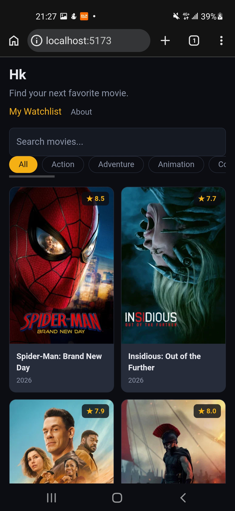
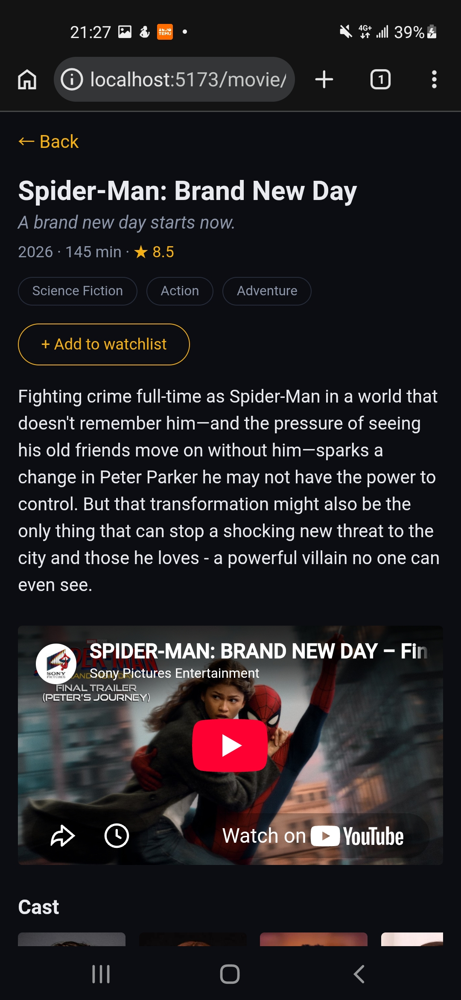
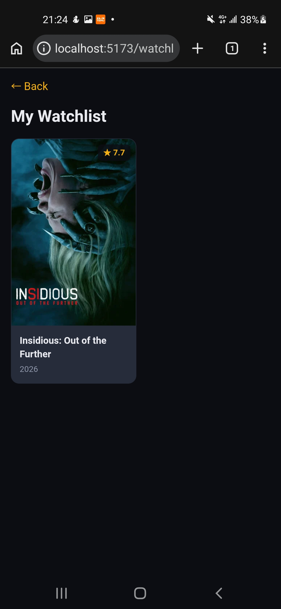
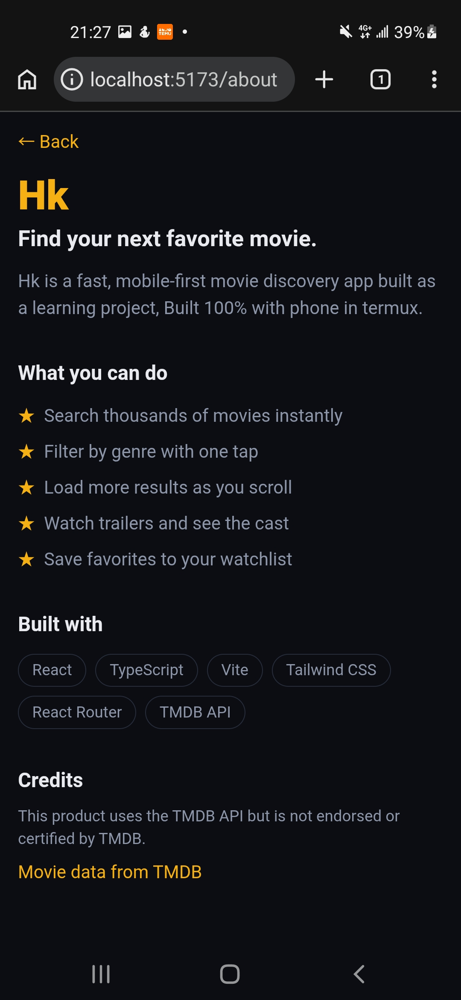

# Hk

Find your next favorite movie. A fast, mobile-first movie discovery app built 100% on a phone using Termux.

## Screenshots

| Home | Detail | Watchlist | About |
| --- | --- | --- | --- |
| 



 | 



 | 



 | 



 |

## Features

- Search thousands of movies with debounced input
- Filter by genre with one tap
- Load more results (pagination)
- Movie detail page with trailer, cast and genres
- Watchlist saved in localStorage
- Installable PWA with offline support
- Loading skeletons and friendly error states

## Tech stack

React, TypeScript, Vite, Tailwind CSS v4, React Router, vite-plugin-pwa, TMDB API

## Run it locally

```bash
git clone https://github.com/Haez0004/movie-app.git
cd movie-app
npm install
